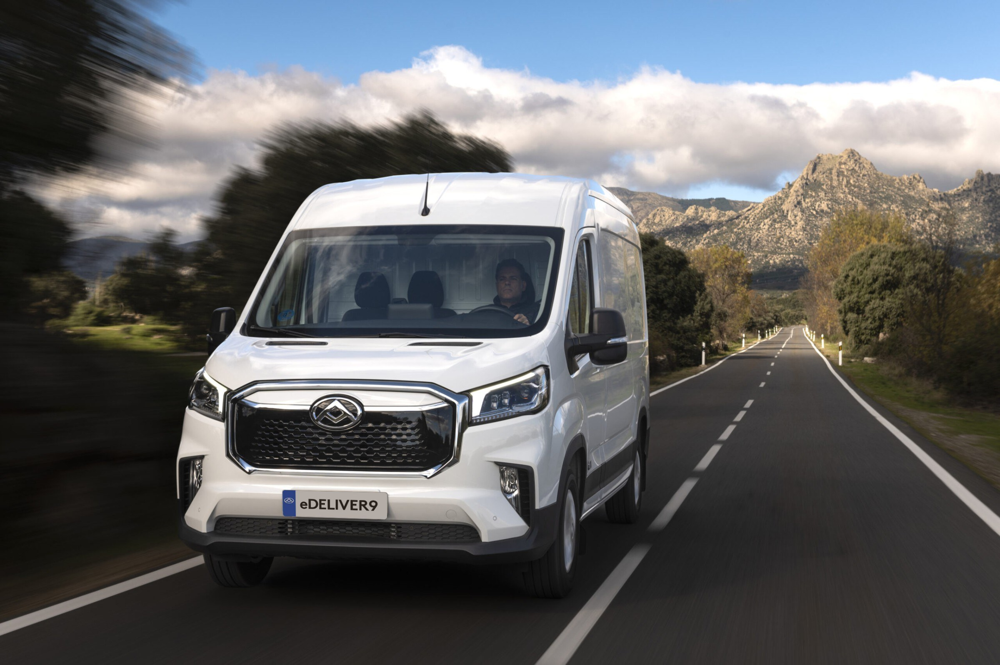

# eDELIVER 9 产品详情页（PDP）· Codex 实现说明 v2（详细版）

> **直接发给 Codex 的指令（复制即可）：**
>
> 在「MAXUS 全球站首页离线包」（2026-10-07 版）的同级目录，新增产品详情页 `pdp-edeliver9.html`。
> 头部、公告栏、页脚、字体、颜色、文字链接、Tab、计数动画、缩放变量全部**复用首页现有的 DOM、class 和 JS 写法**，不要重新造一套。
> 页面模块、文案、尺寸、交互全部按本 README 执行；视觉以 Figma 主稿为准；数据从 `pdp-data.json` 读取。
> 先按 §11「建议开发顺序」逐步完成，每完成一步自查 §12 验收清单。
> 不要修改 `styles.css` / `app.js`；新增样式写在 `pdp.css`，新增交互写在 `pdp.js`。必须离线可用（file:// 双击能打开）。

---

## 0. 资料清单

| 资料 | 位置 | 用途 |
|---|---|---|
| 首页离线包 | `MAXUS首页_双击打开此文件.html`、`styles.css`、`app.js`、`global-presence.css/js`、`assets/` | **复用**：头部、公告栏、页脚、字体、颜色、`.text-link`、`.vehicle-tab`、`.stat` 计数、`--viewport-fit-scale` 缩放、弹窗 `dialog` 写法 |
| PDP Figma 主稿 | 文件 `t04UkR2aPHLl8ItPu4te20` → 页面「PDP 20261009」→ 画板「eDELIVER 9｜PDP 设计稿｜2026-10-11」（node `491:6`） | **视觉唯一标准** |
| 弹窗画板 | 同页「弹窗｜Details 卡片点击「+」展开（1920×1080）」（node `557:102`） | §4-06b 弹窗 |
| 历史 / 备选画板 | 「PDP 上一版」「PDP 第一版」「备选｜04 尺寸」 | 仅参考，**不实现** |
| 产品图 | 本目录 `assets/pdp/*.jpg`（27 张，按用途命名，最长边约 2400px） | 拷到 `assets/pdp/`，可转 webp |
| 页面数据 | 本目录 `pdp-data.json` | 版本参数、文案、热点坐标、图片映射 |
| 旧交互原型 | 仓库 `prototype/maxus-edeliver9-pdp.html` | 只参考 ADAS SVG 叠加层和充电动画写法，**视觉不要照抄** |

---

## 1. 交付物与文件结构

```
pdp-edeliver9.html        新页面（与首页 html 同级）
pdp.css                   只写 PDP 新增样式（≈ 所有 .pdp-* 类）
pdp.js                    PDP 交互（无依赖，ES2019，可用首页已加载的 Lenis）
pdp-data.json             也可以内联成 <script type="application/json" id="pdpData">，保证 file:// 可读
assets/pdp/*.jpg|webp     产品图
```

- `<head>` 引用顺序：`assets/vendor/lenis.css` → `styles.css` → `pdp.css`。
- `<body>` 末尾脚本顺序：`lenis` → `app.js` → `pdp.js`（都用 `defer`）。
- `app.js` 里对首页特有节点（地图、车型 Tab、科技视频等）的 `querySelector` 可能返回 `null`：**如果因此报错，只在 `pdp.js` 里做兼容，不改 `app.js`**。如确实绕不开，在交付说明中列出对 `app.js` 的最小改动。
- **file:// 下 `fetch('pdp-data.json')` 会被浏览器拦截**，所以请把 JSON 内联进 html（`<script type="application/json" id="pdpData">`），`pdp.js` 用 `JSON.parse(document.getElementById('pdpData').textContent)` 读取。

---

## 2. 设计基础（与首页一致）

### 2.1 颜色

| Token | 值 | 用途 |
|---|---|---|
| `--ink` | `#080a0d`（Figma 用 `#0A0A0B`） | 主文字、选中描边 |
| `--muted` | `#6e7787`（Figma Gray 600 `#5A5F68`） | 次级文字、未选中 Tab |
| Gray 400 | `#8A8F98` | 脚注、TBC、版本号灰字 |
| `--line` | `#d6d8dc` / 黑 12% | 分隔线 |
| Surface | `#F1F1F0` | 浅灰模块底 |
| Warm surface | `#F2F0ED` | Details 模块底 |
| Navy | `#070A11` | 深色模块底、渐变色 |
| Surface dark | `#0C0D0F` | Specs 模块底 |
| `--blue` | `#1E5FC8` | **只用于** hover、选中、进度、推荐列；不做大面积色块 |

### 2.2 字体与字号（桌面 1920 基准，全部写成 `calc(var(--viewport-fit-scale,1) * Npx)`）

| 样式 | 字体 | 字号 / 行高 / 字距 | 用途 |
|---|---|---|---|
| Display | Michroma 400 | 72 / 1.12 / -2% | 首屏 `eDELIVER 9` |
| H1 | Michroma 400 | 56 / 1.15 / -2% | 模块大标题 |
| H2 | Michroma 400 | 44 / 1.18 / -1.5% | Explore 标题、Specs 标题、弹窗标题 |
| Card Title | Geist 400 | 32 / 1.25 / -1.5% | 版本名 |
| H4 | Geist 500 | 24 / 1.3 / -1% | 小标题、选中 Tab |
| Data | Geist 300 | 96（参数行 40–60） / 1.0 / -5% | 大数字 |
| Body L | Geist 400 | 22 / 1.5 | 模块导语 |
| Body M | Geist 400 | 20 / 1.5 | 正文 |
| Body S | Geist 400 | 16 / 1.45 | 说明、卡片描述 |
| Button | Geist 500 | 16 / 1.2 | 文字链接 |
| Mono | Geist Mono 400 | 14 / 1.4，大写 | 小标签（`SAFETY`、`01 / 05`） |
| 脚注 | Geist 400 | 12–14 | `* / ** / †` 说明 |

> **Michroma 的 `%` 字形像「0/o」**：标题里出现 `%` 时，用 `<span class="pdp-pct">%</span>` 单独改成 Geist 300。

### 2.3 间距与圆角

- 左右边距：`--page-pad`（1920 下 = 120）。
- 模块上下内边距：100（深色全屏图模块为 0）。
- 小标签 → 标题：24；标题 → 导语：24；标题组 → 内容：56–80。
- 卡片间距 12；文字与箭头 10；列间距 40。
- 圆角：卡片 / 面板 / 大图 **6px**；缩略图 / 内部小按钮 / 标签 **4px**；圆形按钮除外。

### 2.4 公共组件（全页统一，只写一次）

| 组件 | 规格 |
|---|---|
| **文字链接** `.text-link` | 直接用首页的。Button 字号，文字 + 16px 箭头，间距 10，hover 文字变蓝、箭头右移 4px（0.3s）。**除订阅外，全页不做实心按钮。** |
| **Tab** | 复用首页 `.vehicle-tab` 观感：未选中 Body L 22 / `--muted`；选中 H4 24 / `--ink` + 下方 2px 下划线（宽度 = 文字宽，间距 10）；Tab 之间 40。深色背景上颜色反白，未选中 65% 白。`role="tablist"` + `role="tab"` + `aria-selected`，方向键切换。 |
| **轮播控制条** | 左：N 条 56×2 进度短线（间距 8），当前项为 `--ink` 并在 6s 内从 0 走满；中：`01 / 05`（Mono，`--muted`）；右：两个 48px 圆形按钮——上一张白底 + 12% 描边 + 黑箭头，下一张蓝底 + 白箭头；hover 均变蓝底白箭头。 |
| **磨砂标签 / 面板** | 背景 `rgba(10,10,11,.42–.55)` + `backdrop-filter: blur(30–40px)` + 1px `rgba(255,255,255,.14–.2)` 描边。标签圆角 4，面板圆角 6。 |
| **圆形 +** | 40px，`rgba(10,10,11,.55)` + blur 20，白色 14px 加号；展开态加号旋转 45° 变 ×。 |
| **热点** | 白色 40px 圆 + 黑色加号 + 外圈呼吸光圈（2.4s 循环）；激活态蓝底白 ×。 |
| **脚注** | 模块底部，Body S 12–14，Gray 400；`*`、`**`、`†` 必须保留，不能删。 |

---

## 3. 页面结构（从上到下，共 15 段）

| 序 | 区块 id | 名称 | 背景 | 高度（1920 基准） |
|---|---|---|---|---|
| 0 | — | 公告栏 + 头部（复用首页） | — | 48 + 80 |
| 1 | `#top` | 首屏 Hero | 全屏图 | 1080（含头部共 1128） |
| 2 | `#overview` | Explore eDELIVER 9（沉浸式视角舞台） | 全屏棚拍图 | 1280 |
| 3 | `#loadspace` | 11 m³ of working space | 白 | 约 1000 |
| 4 | `#charging` | 10–80% DC charging | 全屏图（深） | 1000 |
| 5 | `#details` | Details that do the work（+ 弹窗） | `#F2F0ED` | 约 900 |
| 6 | `#conversions` | A base for specialist work | 白 | 约 340 |
| 7 | — | 改装示例 Minibus | 全屏图 | 880 |
| 8 | — | Deliveries ahead | 全屏图 | 880 |
| 9 | `#cabin` | A connected place to work | 白 | 约 1340 |
| 10 | `#safety` | Help for the road ahead | 白 | 约 1300 |
| 11 | `#gallery` | Inside and out | `#F1F1F0` | 约 1500 |
| 12 | `#specs` | eDELIVER 9 Specs | `#0C0D0F` | 约 1100 |
| 13 | `#versions` | Compare versions | 白 | 约 1600 |
| 14 | `#faq` | More about eDELIVER 9 | 白 | 约 900 |
| 15 | `#find` | Find your eDELIVER 9 | 全屏图 | 880 |
| 16 | — | 页脚（复用首页） | — | — |

> 注意：Specs 放在 Gallery 之后、Compare 之前（客户要求）。原「A closer look」已并入第 2 段，不单独存在。

---

## 4. 各区块详细说明（英文文案逐字使用，不要改写）

### 1 · 首屏 Hero `#top`

**结构（照首页 `.hero` 结构写）**
```html
<section class="hero pdp-hero" id="top">
  <div class="hero__media"></div>
  <div class="hero__headline"><h1>eDELIVER 9</h1></div>
  <div class="hero__baseline"></div>
  <div class="hero__footline">
    <span>ELECTRIC LARGE VAN</span>
    <p>The van that powers productivity.</p>
    <span class="pdp-hero__links">
      <a class="text-link" href="#find">Find Your Local MAXUS →</a>
      <a class="text-link" href="#overview">Explore eDELIVER 9 ↓</a>
    </span>
  </div>
</section>
```
- 图片 `object-fit:cover; object-position:center top`，**不能拉伸**。
- 渐变：顶部 Navy 0→55% 透明度（覆盖导航区，约前 40%）；底部 Navy 从 66% 位置开始到底部 92%，保证底栏可读。**中间区域不要压暗，车要亮。**
- 标题位置：**居中，放在画面上部**（距顶约 184，避免压住车顶）。不要放在首页的 78% 位置，否则会压住车。
- 底栏左列 / 中列沿用首页 footline 样式；右列放两个白色 `.text-link`，右对齐，间距 48；第二个链接箭头朝下（旋转 90°）。
- 动效：图片 `scale(1.08)→1`，2.6s；标题、底栏淡入上移（同首页节奏）。

### 2 · Explore eDELIVER 9 `#overview`（沉浸式视角舞台）

**布局（1920×1280，背景就是全屏棚拍图）**
- 背景图：当前视角图，`object-fit:cover`，铺满整块；整块背景色 `#B5B8BD` 兜底。
- 顶部居中：H2 `Explore eDELIVER 9`（top 96）；下方 28 处 Tab `L2H2 / L3H2 / L3H3`（默认 L3H2）。
- 底部提亮渐变：从 70% 高度起，`rgba(242,242,242,0)` → 底部 85%。
- 底部左：Card Title / H1 字号的 `eDELIVER 9 L3H2`（随 Tab 变化）。
- 底部右：参数行（auto layout，项间 32，项之间 1px×64 竖线，10% 黑）：

  | 数值 | 单位 | 说明 |
  |---|---|---|
  | 88 | kWh* | Battery capacity |
  | 11 | m³* | Loadspace |
  | 150 | kW* | Max motor power |
  | 51 | min** | DC 10–80% |
  | £XX,XXX | † | Starting price |

  数值 Data 40px，单位 Body S 18px，说明 Body S 14px `--muted`。
- 最底部脚注（12px）：`*26.5MY eDELIVER 9 L3H2 FWD N1 Cargo Van, 88 kWh battery.  **DC 90 kW; time varies with charger, battery condition and temperature.  †Price placeholder, set per market.`

**右侧视角切换**
- 位置：右边距 120，从 y≈350 开始。
- 视角名（H4，右对齐，如 `Front three-quarter`）→ `01 / 03`（Mono）→ 三张缩略图竖排。
- 缩略图 168×112，圆角 6，间距 12；当前项 2px `--ink` 内描边、100% 不透明，其余 60% 不透明 + 1px 白 60% 描边；hover 100%。
- 缩略图下方：360° 图标（24px）+ `Drag to rotate`（Body S，`--muted`）。

  | 序 | 视角名 | 图片 |
  |---|---|---|
  | 01 | Front three-quarter | `studio-l45-doors-open.jpg` |
  | 02 | Rear | `studio-rear.jpg` |
  | 03 | From above | `studio-top-view.jpg` |

**X / Y 尺寸轴（只在视角 01 显示）**
- X 轴（车长）：车身下方一条水平虚线（1px，`#0A0A0B` 45%，dash 5/5），两端 12px 竖向端点；正中下方标注 `X · Overall length  TBC mm`（Body S 14，`--muted`）。
- Y 轴（车高）：车身左侧一条竖向虚线，两端 12px 横向端点；标注 `Y · Overall height  TBC mm`，文字旋转 90°。
- 1920 下坐标参考（相对区块左上）：X 轴 y=1040、x 360→1560；Y 轴 x=300、y 330→1000。实现时用百分比定位跟随图片缩放。
- 切换到 02 / 03 视角时尺寸轴淡出（0.3s），回到 01 淡入。

**交互**
1. 点击缩略图 → 背景图交叉淡入 0.6s（新图 `scale 1.02→1`），视角名和序号同步更新。
2. 在图上按住左右拖拽：每移动 120px 切换一个视角（循环）；鼠标样式 `grab / grabbing`；移动端支持触摸，竖向滚动不受影响（`touch-action: pan-y`）。
3. 键盘：缩略图可 Tab 聚焦，Enter 切换；聚焦舞台时左右键切换。
4. 版本 Tab：切换时名称变成 `eDELIVER 9 L2H2/L3H2/L3H3`，参数数字重新计数（1.4s，ease-out）；没有数据的显示 `TBC`（Gray 400，不计数）。
5. 预加载 3 张视角图，避免切换闪白。

### 3 · 11 m³ of working space.* `#loadspace`

- 白底。左上 Mono `LOADSPACE` → H1 `11 m³ of working space.*`（`³` 用上标）。
- 下方两栏：左列表 520 宽，右大图 1100×720（圆角 6），两栏间距约 60，顶对齐。
- 左列表三项（每项上方 1px 分隔线；当前项上方叠一条 2px 蓝色进度线，6s 走满后自动切到下一项）：

  | 序 | 标题（H4） | 描述（Body M，仅当前项展开） | 右侧图片 |
  |---|---|---|---|
  | 01 | 11 m³ loadspace* | A 3,413 mm-long loadspace gives equipment and deliveries room on board, with a flat floor and cargo lighting. | `loadspace-interior.jpg` |
  | 02 | Rear doors to 253°* | Wide-opening rear doors fold back against the body for forklift and pallet access. | `rear-doors-open.jpg` |
  | 03 | Sliding side door | Load from the kerb and reach the cab without stepping out. | `studio-l45-doors-open.jpg` |

- 序号 Mono：当前项蓝色，其余 Gray 400；未选中标题 `--muted`，hover 变蓝。
- 展开动画：描述高度 0→auto + 透明度，0.5s；右图交叉淡入 0.6s。点击某项重置进度计时；鼠标悬停列表时暂停自动切换。
- 列表底部脚注：`*Figures refer to the 26.5MY eDELIVER 9 L3H2 FWD N1 Cargo Van with an 88 kWh battery. Specifications vary by market and version.`

### 4 · Charging `#charging`（1920×1000，深色全屏）

- 背景：`depot-side-charging-bg.jpg`。**等比 cover，绝对不能拉伸**。车放在画面右侧、完整露出（1920 下图片宽约 1560，靠右下对齐，底部略出血 20）。
- 左侧渐变：Navy 从左 0%（100%）→ 26%（100%）→ 42%（55%）→ 55%（0%）；底部加一层 Navy 0→70% 的轻渐变。
- 左上文字（白）：
  - Mono `CHARGING`（60% 白）
  - H1：`10–80% DC charging` / `in 51 minutes.**`（`%` 用 Geist 300）
  - Body L（75% 白，宽 640）：`DC and AC charging support different charging routines. Liquid heating and cooling help manage the battery's temperature as conditions change.`
- 左下充电面板（720×440，磨砂深色 45% + blur 40 + 白 16% 描边，圆角 6，x=120，y=480）：
  1. 第一行：Mono `DC FAST CHARGE · 90 kW`（60% 白），右侧 `Replay ↻`（Button 15，可点）。
  2. 大数字：`51` Data 96 + `min` 36（80% 白）；右侧 `10% → 80%`（Body M 18，70% 白）。
  3. 电量条：40 格，每格高 28、间距 4、圆角 2；已充电格蓝色 `#1E5FC8`（前 4 格为 10% 底电，用 `#4C8BF0` 50%）；未充电格白 12%。10% 和 80% 位置各有一条 40px 高的白 50% 竖刻度，下方标 `10%`、`80%`（Mono 12）。
  4. 分隔线（白 30%，每项上方 200 宽）。
  5. 三项：`88 kWh` / Battery capacity*，`90 kW` / DC charging power**，`AC` / Depot & overnight（数值 Data 56 + 单位 24；说明 Body S 15，65% 白），列宽 240。
- 底部脚注（45% 白）：`**10–80% DC charging: 51 minutes at 90 kW. Actual time varies with charger output, battery condition, temperature and other conditions.  *26.5MY eDELIVER 9 L3H2, 88 kWh battery.`

**交互**
- 进入视口（50%）自动播放一次：4.2s，ease-out；电量格从第 4 格逐格点亮到第 32 格（80%）；分钟数从 0 计到 51。
- `Replay` 重新播放。
- 减弱动效：直接显示 80% 和 51。

### 5 · Details that do the work. `#details`（含弹窗）

- 背景 `#F2F0ED`。Mono `DETAILS` → H1 `Details that do the work.`
- 卡片横向轨道：卡片 400×520，白底，圆角 6，间距 12，左侧对齐 `--page-pad`，右侧溢出可滑动。
- 卡片内容：顶部 20 内边距，标题 Body S 15（`--ink`）→ 描述 Body L 21（`--muted`，宽 360）→ 底部图片（卡片内缩 6px，高 288，圆角 4）→ 图片右下角圆形 `+`（距右 / 下 16）。

  | 序 | 标题 | 描述 | 图片 | 弹窗内 3 张小图 |
  |---|---|---|---|---|
  | 01 | Full LED headlights | Clear light for early starts and late drops. | `detail-headlight.jpg` | headlight / gallery-headlight-2 / detail-headlight（同部件多角度，拿到新图后替换） |
  | 02 | Chrome-framed grille | The eDELIVER 9 face, built to take daily wear. | `detail-grille.jpg` | grille / studio-front / gallery-front-corner |
  | 03 | 253° rear doors* | Fold back against the body for pallet loading. | `rear-doors-open.jpg` | rear-doors-open / studio-rear / loadspace-interior |
  | 04 | Steel wheels | Covers that shrug off kerbs and loading bays. | `detail-wheel.jpg` | detail-wheel / studio-l45-doors-open / gallery-front-corner |
  | 05 | Tall rear lamps | Seen above the load, day and night. | `detail-taillight.jpg` | detail-taillight / studio-rear / rear-doors-open |

- 下方轮播控制条（§2.4），`01 / 05` 居中。
- 拖拽 / 触摸横滑；滚轮横向不劫持页面竖向滚动。

**弹窗（点击卡片或 `+` 打开；对应 Figma node `557:102`）**
- 用 `<dialog>`（与首页 `.utility-dialog` 写法一致），`showModal()`。
- 遮罩：Navy 72% + `backdrop-filter: blur(12px)`。
- 面板：1520×840 居中（视口小于 1600 时宽 = 视口 − 2×page-pad，高 = 宽 × 0.55，最多 90vh），白底，圆角 6，`overflow:hidden`。
- 左：大图（面板宽 63%，cover）。
- 右栏（左右内边距 64）：
  1. `01 / 05`（Mono，`--muted`），top 64。
  2. 标题 H2（44），宽度自适应换行。
  3. 卡片原句（Body L，`--muted`）。
  4. 补充说明（Body S，`--muted`）。01 的示例：`LED lighting gives a bright, even beam on unlit roads and in loading yards. Fitment and lighting functions vary by market and version.`（其余 4 项先用卡片原句 + 同样的「Fitment … vary by market and version.」结尾，**待客户确认文案**）。
  5. 3 张小图 112×76，间距 12，圆角 4；当前项 2px `--ink` 内描边，其余 55%；点击切换左侧大图（交叉淡入 0.4s）。
  6. 底部：5 条 40×2 进度短线（当前黑），右侧上一项 / 下一项圆形按钮（下一项蓝底）。
- 右上角 48px 圆形关闭按钮（`#F1F1F0` 底 + 黑 ×），`aria-label="Close"`。
- 关闭方式：×、点击遮罩、Esc。
- 键盘：左右方向键切换 5 项；打开时焦点移到关闭按钮，Tab 键在弹窗内循环，关闭后焦点回到触发的那个 `+`。
- 打开时锁定页面滚动（Lenis `stop()` / `start()`）。
- 动效：遮罩淡入 0.3s；面板从被点卡片的位置和尺寸放大到居中（FLIP，0.45s，`cubic-bezier(.22,.61,.36,1)`）；关闭反向。减弱动效模式下直接淡入。

### 6 · A base for specialist work. `#conversions`

- 白底，只有标题区：Mono `CONVERSIONS` → H1 `A base for specialist work.` → Body L（`--muted`，宽 1080）：`Available power take-off interfaces and bodybuilder connections support approved conversions. Match the vehicle and equipment to the work your business needs to do.`

### 7 · 改装示例 Minibus（1920×880 全屏）

- 背景 `minibus-conversion-street.jpg`，视差（§5）；底部 Navy 0→60% 渐变（底部 40%）。
- 左下 Mono 白 75%：`EXAMPLE CONVERSION · MINIBUS`。
- 右下磨砂卡（560×460，圆角 6，距右 120、距底 80）：
  - 顶部 Tab（深色版首页 Tab，字号 18/20）：`Exterior` / `Seating layout`（默认 Seating layout）。
  - 图片区 520×292，圆角 4：Exterior → `minibus-conversion-alt.jpg`（cover）；Seating layout → `minibus-seating-layout.jpg`（contain，`#E3E3E3` 底）。切换淡入 0.4s。
  - 文案（Body S，85% 白）：`Cargo van, minibus or a body of your own. Talk to your local MAXUS team about approved converters.`

### 8 · Deliveries ahead（1920×880 全屏）

- 背景 `city-delivery-side-door.jpg`，视差；顶部 Navy 70%→0（前 42%）。
- 左上 H1 白：`Deliveries ahead.` / `Electric power on board.`（top 120）。

### 9 · A connected place to work. `#cabin`

- 白底。Mono `CABIN` → H1 → Body L：`A column-mounted drive selector, central touchscreen and smartphone connectivity keep driving controls and everyday tools within reach.`
- 大图 1680×880，圆角 6：`cabin-cockpit.jpg`。
- 4 个热点（§2.4 样式），位置为相对图片宽高的百分比：

  | 序 | 位置 (x%, y%) | 卡片小标签 | 标题 | 描述 |
  |---|---|---|---|---|
  | 01 | 49.8, 35.3 | 01 · TOUCHSCREEN | Central touchscreen | Navigation, media and vehicle settings, with smartphone connectivity. |
  | 02 | 30.9, 43.6 | 02 · DISPLAY | Digital driver display | Speed, range and charge level in one clear view. |
  | 03 | 45.8, 47.8 | 03 · DRIVE SELECTOR | Column-mounted drive selector | Frees up the space between the seats for a third passenger. |
  | 04 | 74.4, 69.9 | 04 · SEATS | Three seats across | Room for a crew of three, with storage under the passenger bench. |

- 说明卡：磨砂深色，400 宽，圆角 6，内边距 22/24；出现在热点右侧 36px；若超出图片右边界则放到左侧。小标签 Mono 70% 白 → H4 20 白 → Body S 85% 白。
- 默认展开 01；点击另一个热点切换；再次点击当前热点收起。
- 左下磨砂提示：`TAP + TO EXPLORE THE CABIN`（Mono）。

### 10 · Help for the road ahead. `#safety`

- 白底。左上 Mono `SAFETY` → H1 `Help for the road ahead.`（**图片上不放任何文字**）。
- 大图 1680 宽（高约 840），圆角 6：`adas-winding-road.jpg`；车要完整露出，包括车头和保险杠。
- 图上 SVG 叠加层（viewBox 1500×1000，`preserveAspectRatio="xMidYMid slice"`），三组，只显示当前一组：
  - **ACC**：车前蓝色扇形渐变（#4C8BF0 60%→0）+ 三道向前的白色弧线波纹，2.4s 循环依次闪烁。
  - **Lane-keeping**：两侧车道线高亮（蓝 8px 线 + 白色细线脉冲）。
  - **Emergency braking**：车前三圈同心椭圆向外扩散脉冲 + 中心蓝点。
  - 坐标直接参考旧原型 `prototype/maxus-edeliver9-pdp.html` 里的 `#adas svg.ov`。
- 图下三列（列宽 = (1680−80)/3，列间 40，图下 40）：
  - 顶部 2px 线（当前 `--ink`，其余 12%）→ Mono 序号（当前蓝）→ H4 标题 → Body S 描述。
  - 当前列 100% 不透明，其余 45%。

  | 序 | 标题 | 描述 |
  |---|---|---|
  | 01 | Adaptive cruise control | Keeps a set distance to the vehicle ahead, slowing and resuming with traffic. |
  | 02 | Lane-keeping support | Helps keep the van centred when lane markings are visible. |
  | 03 | Emergency braking | Watches the road ahead and can brake automatically if a collision is likely. |

- 交互：点击列切换；每 6s 自动切换，当前列顶部的线作为进度条走满；叠加层切换时淡入 0.6s。

### 11 · Inside and out. `#gallery`

- 背景 `#F1F1F0`。Mono `GALLERY` → H1 `Inside and out.` → Tab `Exterior` / `Interior`（下方 1px 通栏分隔线）。
- 大图 1680×882，圆角 6；左右各一个 56px 圆形箭头（上一张白 72%，下一张蓝）；左下磨砂标签 `01 · ON THE ROAD`（Mono）。
- 下方缩略图条：6 列，间距 12，高 180，当前项 100% + 底部 2px 蓝线，其余 50%。超过 6 张横向滚动。

  | Tab | 图片（按顺序） | 标签 |
  |---|---|---|
  | Exterior | hero-mountain-road, detail-grille, gallery-headlight-2, detail-taillight, detail-wheel, gallery-front-corner, gallery-city-road | On the road / Grille / Headlight / Rear lamp / Wheel / Front corner / City |
  | Interior | cabin-cockpit, cabin-touchscreen, cabin-dashboard, cabin-seating, gallery-cab, gallery-loadspace-2 | Cockpit / Touchscreen / Dashboard / Seating / Cab / Loadspace |

- 切换 Tab 重置到第 1 张；大图交叉淡入 0.6s；支持键盘左右键与触摸滑动。

### 12 · eDELIVER 9 Specs `#specs`（深色，**不放图片**）

- 背景 `#0C0D0F`，文字白。
- 顶部：左 H2 `eDELIVER 9 Specs`；右侧深色版 Tab：`L2H2 Cargo Van` / `L3H2 Cargo Van`（默认）/ `L3H3 Cargo Van`。
- 三组，组标题 H4 22；组内为 **5 列网格**（列宽 = 1680/5），每项「小灰标签 Body S 15 55% 白 → 值 Body M 18 白」，行间距 100；组与组之间 1px 白 12% 分隔线（上下各 56–64）。

  | 组 | 项（标签 → L3H2 值） |
  |---|---|
  | Performance | Battery capacity → 88 kWh* · Maximum power → 150 kW* · Maximum torque → 330 Nm* · Drive → Front-wheel drive · DC charging, 10–80% → 51 min** |
  | Dimensions | Loadspace → 11 m³* · Loadspace length → 3,413 mm* · Rear door opening → 253°* · Overall length → TBC mm · Overall height → TBC mm · Overall width → TBC mm · Seating → 3 seats · Display → Central touchscreen · Payload → TBC kg |
  | Charging | DC charging power → 90 kW** · DC 10–80% → 51 min** · AC charging → TBC kW · Battery heating and cooling → Liquid |

- 脚注（40% 白）：`*26.5MY eDELIVER 9 L3H2 FWD N1 Cargo Van with an 88 kWh battery. Power and torque figures are maximum outputs.  **Actual charging time varies with charger output, battery condition, temperature and other conditions.  TBC: to be confirmed per version and market.`
- 交互：切 Tab 时所有值淡出（0.15s）→ 替换 → 淡入（0.25s）；数据从 `pdp-data.json` 读取；空值显示 `TBC`。

### 13 · Compare versions. `#versions`

- 白底。Mono `EDELIVER 9 VERSIONS` → H1 `Compare versions.` → Body L（`--muted`，宽 900）：`Every version shares the same design and electric drive. Body length and roof height change what you can carry.`；右上 `.text-link` `Compare all specifications →`。
- 「共同配置」浅灰条（1680×96，`#F1F1F0`，圆角 6）：Mono `SAME ON EVERY VERSION`，下方一行，项之间 1px 竖线：`88 kWh battery*` · `150 kW / 330 Nm motor*` · `90 kW DC charging**` · `Adaptive cruise · Lane-keeping · AEB` · `Central touchscreen`。
- 对比表：左侧行标题列 280 宽，右侧三列等宽（(1680−280)/3）。**所有行三列严格对齐**，行与行之间 1px 12% 分隔线。
  - **推荐列 L3H2**：整列 `#F4F6FA` 底 + 顶部 2px 蓝线。
  - **表头**（每列）：
    1. 标签（4px 圆角）：L3H2 为黑底白字 `MOST POPULAR`，其余为浅灰底 `26.5MY`。
    2. 车图：同高 260，圆角 4，cover。L2H2 用 `studio-front.jpg`，L3H2 用 `studio-l45-doors-open.jpg`，L3H3 用 `studio-rear.jpg`（三张必须不同；拿到各版本实拍后替换）。
    3. `eDELIVER 9` + 版本号（Card Title 32，版本号 Gray 400）。
    4. 车身描述（Body S `--muted`）。
    5. `From £XX,XXX excl. VAT†`（Body M 18）。

  | 行 | L2H2 | L3H2 | L3H3 | 样式 |
  |---|---|---|---|---|
  | 车身描述 | Medium length · High roof | Long · High roof | Long · Extra-high roof | Body S |
  | Loadspace（行标题下 Mono 蓝 `KEY DIFFERENCE`） | TBC | 11 m³* | TBC | Data 56；TBC 用 Gray 400 |
  | Loadspace length（`KEY DIFFERENCE`） | TBC | 3,413 mm* | TBC | Data 56 |
  | Roof height | High | High | Extra-high（右侧 8px 蓝点） | H4 |
  | Best for | Urban multi-drop routes and tighter streets. | Parcel, trade and fleet work that needs more floor length. | Standing-height loading and tall cargo. | Body M 18 |
  | 链接 | Explore L2H2 → | Explore L3H2 →（蓝） | Explore L3H3 → | `.text-link` |

- 脚注：`*26.5MY eDELIVER 9 L3H2 FWD N1 Cargo Van with an 88 kWh battery.  **Actual charging time varies.  †Price placeholder; prices and versions vary by market.  TBC: to be confirmed per version.`
- 交互：hover 某列整列浅底高亮（非推荐列用 `#F7F7F6`）；移动端改为横向滑动的三张卡，行标题跟随在每个值上方。

### 14 · FAQ `#faq` — More about eDELIVER 9

- Mono `FAQ` → H1 `More about eDELIVER 9`；手风琴，每项上下 1px 分隔线，问题 H4，右侧 16px `+`（展开时竖线旋转成 `−`），答案 Body M `--muted` 宽 1080，展开 0.45s。第一项默认展开，可多项同时展开。

  1. **Where can I find local specifications?** — Visit your local MAXUS website for the versions, specifications and support available in your market.
  2. **Which manual should I use?** — Use the manual for your vehicle's model year and market. You'll find it under Manuals & Guides on your local MAXUS website.
  3. **How much loadspace does the eDELIVER 9 offer?** — The L3H2 FWD N1 Cargo Van offers 11 m³, with a loadspace length of 3,413 mm.* Other versions vary.
  4. **Can I use AC and DC charging?** — Yes. DC charging at up to 90 kW takes the battery from 10% to 80% in 51 minutes.** AC charging suits depot and overnight routines.
  5. **Can the eDELIVER 9 support specialist conversions?** — Yes. Available power take-off interfaces and bodybuilder connections support approved conversions. Your local MAXUS team can put you in touch with converters.

- 用 `<button aria-expanded aria-controls>` 实现。

### 15 · Find your eDELIVER 9 `#find`（1920×880）

- 背景 `find-city-minibus.jpg`，**等比**（1920 下图片宽约 2100，cover 后车在右侧），背景色 Navy 兜底。
- 只加左侧渐变：Navy 85% → 28% 处 55% → 45% 处 0。**不要整屏压暗。**
- 左对齐（x=120，垂直居中偏上，y≈320）：H1 两行 `Find your` / `eDELIVER 9.` → Body L（宽 460，86% 白）`Explore the versions, availability and support offered in your market.` → 白色 `.text-link` `Choose Your Market →`。
- 点击链接：打开首页已有的 `#countryDialog`（Choose Your Market），复用即可。

### 16 · 页脚

直接复制首页 `<footer class="site-footer">` 整段。

---

## 5. 全局交互

| # | 功能 | 规则 |
|---|---|---|
| 1 | **吸顶子导航** | 滚过首屏底部后，从顶部滑出 64px 白色磨砂条（白 86% + blur 24 + 底部 1px 线）。左：`eDELIVER 9`（Michroma 16）；中：锚点 `Overview · Loadspace · Charging · Details · Conversions · Cabin · Safety · Gallery · Specs · Versions · FAQ`（Body S 15，`--muted`，当前项 `--ink` + 2px 蓝下划线）；右：`.text-link` `Find Your Local MAXUS →`。向下滚动时隐藏主头部（`translateY(-100%)`）只留子导航；向上滚动时主头部回来，子导航下移到主头部下方。锚点点击用 Lenis 平滑滚动，偏移 136。用 IntersectionObserver 做滚动高亮。 |
| 2 | **入场动画** | 带 `.rv` 的元素：`opacity 0 → 1`、`translateY(32px) → 0`，0.9s `cubic-bezier(.22,.61,.36,1)`；同组依次延迟 80ms；只播一次（IntersectionObserver，threshold .18）。 |
| 3 | **数字计数** | 复用首页 `data-count-to` / `data-count-suffix` / `data-count-decimals` 写法，1.4s ease-out cubic，只播一次。 |
| 4 | **视差** | 区块 7、8、15 的背景图：容器 `overflow:hidden`，图片高 124%，按区块中心与视口中心的距离 `translateY(±8%)`。用 rAF 节流。 |
| 5 | **轮播** | 所有自动轮播间隔 6s；鼠标悬停或聚焦时暂停；页面不可见（`visibilitychange`）时暂停。 |
| 6 | **图片加载** | 首屏图 `<link rel="preload">`；其余图片 `loading="lazy" decoding="async"`；切换类模块预加载下一张。 |
| 7 | **无障碍** | 所有 Tab 用 tablist 语义 + 方向键；热点、`+`、箭头按钮都有 `aria-label`；弹窗 `<dialog>` + 焦点管理；颜色对比 ≥ 4.5（深色上的 55% 白小字至少 14px）。 |
| 8 | **减弱动效** | `prefers-reduced-motion: reduce` 时：关闭视差、自动轮播、计数、充电动画、呼吸光圈；切换改为直接替换。 |

---

## 6. 响应式（沿用首页断点）

| 区块 | ≤ 900px | ≤ 600px |
|---|---|---|
| 头部 | 用首页汉堡菜单 | 同左 |
| 子导航 | 锚点区横向滚动 | 只显示 `eDELIVER 9` + 右侧链接，锚点收进下拉 |
| 1 Hero | 标题 52；footline 两栏，链接换到下一行 | footline 单栏 |
| 2 Explore | 缩略图改为图片下方横排；尺寸轴隐藏；参数行换成 3+2 两行 | 参数行横向滚动；舞台高 70vh |
| 3 Loadspace | 列表在上、图片在下 | 同左 |
| 4 Charging | 面板移到图片下方（不叠在图上） | 电量条 20 格 |
| 5 Details | 卡宽 300 | 卡宽 80vw；弹窗全屏、图片在上、文字在下 |
| 7 改装卡 | 卡片移到图片下方 | 同左 |
| 9 Cabin | 热点保留，说明卡改为图片下方固定区域 | 同左 |
| 10 Safety | 三列变一列（只展开当前项描述） | 同左 |
| 11 Gallery | 缩略图 4 列 | 横向滚动 |
| 12 Specs | 3 列 | 2 列；版本 Tab 横向滚动 |
| 13 Compare | 横向滑动的三张卡，行标题跟随在每个值上方 | 同左 |
| 15 Find | 渐变改为底部渐变，文字放到底部 | 同左 |

1920、1440、1024、768、390 五个宽度都要截图自查。

---

## 7. 数据模型（`pdp-data.json` 结构，节选）

```json
{
  "versions": {
    "L2H2": { "label": "Medium length · High roof", "loadspace": null, "loadspaceLength": null, "roof": "High", "bestFor": "Urban multi-drop routes and tighter streets.", "image": "studio-front", "price": null },
    "L3H2": { "label": "Long · High roof", "loadspace": 11, "loadspaceLength": 3413, "roof": "High", "bestFor": "Parcel, trade and fleet work that needs more floor length.", "image": "studio-l45-doors-open", "price": null, "popular": true },
    "L3H3": { "label": "Long · Extra-high roof", "loadspace": null, "loadspaceLength": null, "roof": "Extra-high", "bestFor": "Standing-height loading and tall cargo.", "image": "studio-rear", "price": null }
  },
  "shared": { "battery": 88, "power": 150, "torque": 330, "dcPower": 90, "dc10to80": 51 }
}
```
`null` 一律显示 `TBC`（价格显示 `£XX,XXX†`）。完整文件见本目录 `pdp-data.json`。

---

## 8. 视觉硬性规则（客户反复提过，违反即返工）

1. **图片不能变形**：只用 `object-fit: cover / contain`，禁止固定宽高拉伸背景。
2. **车不能被遮挡**：标题、面板、Tab、热点卡都不能压在车身上；首屏、Explore、充电、Safety、Find 的车要完整露出。
3. **不要整屏压暗**：渐变只加在放文字的一侧。
4. **按钮弱化**：只有订阅是实心按钮，其余都用文字 + 箭头；hover 统一 `#1E5FC8`。
5. **圆角统一**：容器 6、内部元素 4。
6. **不要堆信息**：每块只讲一件事；Specs 不放图。
7. **文案逐字使用**，英文平实；`* / ** / †` 脚注保留。

---

## 9. 图片清单（`assets/pdp/`）

| 文件 | 用在 |
|---|---|
| hero-mountain-road | 1 Hero、11 Gallery |
| studio-l45-doors-open | 2 视角 01、3 列表 03、13 L3H2 |
| studio-rear | 2 视角 02、13 L3H3 |
| studio-top-view | 2 视角 03 |
| studio-front | 13 L2H2 |
| loadspace-interior | 3 列表 01 |
| rear-doors-open | 3 列表 02、5 卡 03 |
| depot-side-charging-bg | 4 Charging |
| detail-headlight / detail-grille / detail-wheel / detail-taillight | 5 Details |
| minibus-conversion-street / minibus-conversion-alt / minibus-seating-layout | 7 改装 |
| city-delivery-side-door | 8 Deliveries |
| cabin-cockpit / cabin-touchscreen / cabin-dashboard / cabin-seating | 9 Cabin、11 Gallery |
| adas-winding-road | 10 Safety |
| gallery-city-road / gallery-headlight-2 / gallery-front-corner / gallery-cab / gallery-loadspace-2 | 11 Gallery |
| find-city-minibus | 15 Find |

---

## 10. HTML 骨架（参考）

```html
<body class="pdp">
  <!-- 首页公告栏 / 头部（整段复制） -->
  <nav class="pdp-subnav" aria-label="eDELIVER 9">…</nav>
  <main>
    <section class="hero pdp-hero" id="top">…</section>
    <section class="pdp-explore" id="overview">
      <div class="pdp-explore__views" role="img" aria-label="eDELIVER 9 views">…3 张 img…</div>
      <h2>Explore eDELIVER 9</h2>
      <div class="pdp-tabs" role="tablist">…</div>
      <div class="pdp-explore__axes" aria-hidden="true">…</div>
      <div class="pdp-explore__thumbs">…</div>
      <div class="pdp-explore__bar"><p class="pdp-explore__name">eDELIVER 9 L3H2</p><dl class="pdp-keyfigs">…</dl></div>
    </section>
    <section class="pdp-loadspace section-shell" id="loadspace">…</section>
    <section class="pdp-charging" id="charging">…</section>
    <section class="pdp-details" id="details">…</section>
    <dialog class="pdp-detail-dialog" id="detailDialog">…</dialog>
    <section class="section-shell" id="conversions">…</section>
    <section class="pdp-bleed pdp-bleed--conversion">…</section>
    <section class="pdp-bleed pdp-bleed--delivery">…</section>
    <section class="pdp-cabin section-shell" id="cabin">…</section>
    <section class="pdp-safety section-shell" id="safety">…</section>
    <section class="pdp-gallery" id="gallery">…</section>
    <section class="pdp-specs" id="specs">…</section>
    <section class="pdp-versions section-shell" id="versions">…</section>
    <section class="pdp-faq section-shell" id="faq">…</section>
    <section class="pdp-find" id="find">…</section>
  </main>
  <!-- 首页页脚 + 首页 dialogs（countryDialog 等）整段复制 -->
  <script type="application/json" id="pdpData">{…}</script>
</body>
```

---

## 11. 建议开发顺序

1. 拷首页的 head、公告栏、头部、页脚和 dialogs，确认 PDP 空页面与首页头尾一致、控制台无报错。
2. 写公共组件：Tab、轮播控制条、磨砂、热点、`+`、`.rv` 入场、计数（§2.4、§5）。
3. 按顺序完成区块 1 → 15，每块先静态还原，再加交互。
4. 吸顶子导航和锚点。
5. Details 弹窗（焦点管理、FLIP 动画）。
6. 响应式（§6）和减弱动效。
7. 性能：图片转 webp、懒加载。
8. 用 Playwright 或手动在五个宽度下截图，对照 Figma 逐块自查，并逐条过 §12。

---

## 12. 验收清单

- [ ] 1920 下与 Figma 主稿逐块对齐（位置、字号、间距误差 ≤ 4px）。
- [ ] 1920 / 1440 / 1024 / 768 / 390：无横向滚动、文字不重叠、车不被遮挡、图片不变形。
- [ ] 头部、公告栏、页脚与首页完全一致（同一 DOM 和 class）。
- [ ] 交互逐项可用：
  - [ ] 子导航出现、隐藏、高亮、锚点跳转
  - [ ] Explore：版本 Tab、参数计数、缩略图切换、拖拽切换、X/Y 轴显隐
  - [ ] Loadspace：列表切换 + 自动进度
  - [ ] Charging：进入视口自动播放 + Replay
  - [ ] Details：轮播、拖拽、`+` 弹窗（打开、切换、小图、关闭、Esc、焦点回归）
  - [ ] 改装卡 Tab
  - [ ] Cabin 热点（翻边、收起）
  - [ ] Safety 三项切换 + 自动进度 + SVG 动画
  - [ ] Gallery：Tab、箭头、缩略图、键盘
  - [ ] Specs Tab 切换数值
  - [ ] Compare 列 hover
  - [ ] FAQ 展开收起
  - [ ] Choose Your Market 弹窗
- [ ] 键盘可完成全部操作；Lighthouse 无障碍 ≥ 90。
- [ ] 减弱动效模式下所有内容可见、无动画。
- [ ] file:// 双击打开正常、控制台无报错、无外部网络请求。

---

## 13. 待客户补充（目前用占位）

| 内容 | 现在显示 |
|---|---|
| 车长 / 车宽 / 车高、载重、AC 充电功率 | `TBC` |
| L2H2、L3H3 的货厢容积和长度 | `TBC` |
| 各市场价格 | `£XX,XXX†` |
| 各版本独立棚拍图 | 暂用不同视角的同一款车 |
| Details 弹窗补充文案、每个部件的多角度图 | 示例文案 / 复用现有图 |
| 真实充电场景图、产品视频 | 用车辆侧面图代替（之前上传的视频压缩包是空的） |
